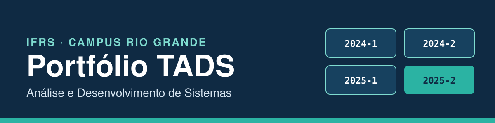
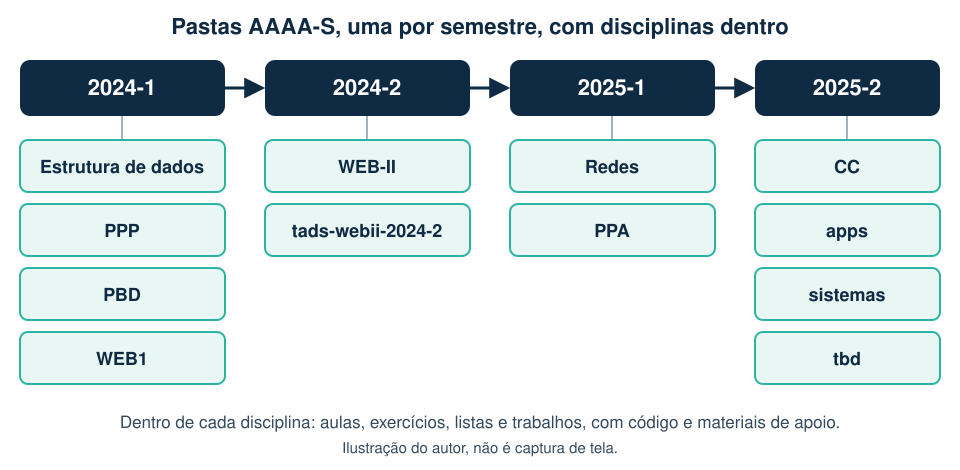

  

# Portfólio acadêmico: TADS (IFRS Campus Rio Grande)

Atividades práticas, exercícios e trabalhos desenvolvidos por Rafael Pinheiro no curso superior de Tecnologia em Análise e Desenvolvimento de Sistemas do IFRS (Campus Rio Grande).

---

## Sobre o repositório

Este repositório reúne o código produzido durante a graduação no Curso Superior de Tecnologia em Análise e Desenvolvimento de Sistemas do Instituto Federal do Rio Grande do Sul (IFRS, Campus Rio Grande).

O curso tem carga horária total de 2.147 horas distribuídas em 6 semestres (3 anos): 2.015 horas de aulas presenciais, 66 horas de Trabalho de Conclusão de Curso (TCC) e 66 horas de Atividades Curriculares Complementares (ACC), segundo o Projeto Pedagógico do Curso (PPC 2022).

O repositório é um portfólio acadêmico com foco prático. O código cobre desde estruturas de dados e ponteiros em C até padrões de projeto (GoF), bancos relacionais e NoSQL, APIs e desenvolvimento web e mobile.

> **Organização:** os arquivos estão divididos por semestre e disciplina em módulos didáticos e exercícios. Não são projetos independentes.

---

## Estrutura por semestre e disciplinas

As pastas estão organizadas por semestre letivo (`AAAA-S`) e disciplina:

*Ilustração em SVG editável (`docs/assets/estrutura.svg`), não é captura de tela.*

| Semestre | Pasta | Componente curricular (PPC 2022) | Conteúdo | Tecnologias |
| :--- | :--- | :--- | :--- | :--- |
| **2024-1** | `Estrutura de dados` | Estruturas de Dados *(4º sem.)* | Listas encadeadas, pilhas, filas, árvores, alocação dinâmica de memória, ponteiros e algoritmos de ordenação e busca. | C |
| **2024-1** | `PPP` | Princípios e Padrões de Projeto *(4º sem.)* | Programação orientada a objetos e padrões de projeto GoF (Builder, Command, Proxy, Decorator, State, Observer, Iterator, Prototype, Strategy), além de leitura de planilhas e geração de relatórios. | Java 17, Maven, Apache POI, PDFBox |
| **2024-1** | `PBD` | Programação em Bancos de Dados *(4º sem.)* | Modelagem relacional, scripts DDL e DML, consultas, gatilhos, procedimentos e integridade referencial. | SQL (PostgreSQL, MySQL) |
| **2024-1** | `WEB1` | Desenvolvimento de Aplicativos Web I *(4º sem.)* | Páginas dinâmicas, processamento no servidor e manipulação de formulários. | PHP, HTML, CSS |
| **2024-2** | `WEB-II` e `tads-webii-2024-2` | Desenvolvimento de Aplicativos Web II *(5º sem.)* | APIs REST, autenticação com JWT e bcrypt, renderização no servidor com templates, ORM e arquitetura MVC. | Node.js, Express, Prisma ORM, EJS, SQLite, PostgreSQL |
| **2025-1** | `Redes` | Redes de Computadores *(5º sem.)* | Comunicação cliente-servidor com sockets TCP e UDP, além de simulação de topologias de rede. | Python (sockets), Cisco Packet Tracer |
| **2025-1** | `PPA` | Princípios e Padrões de Arquitetura *(5º sem.)* | Estrutura inicial para estudos de arquitetura de software corporativo. | Configurações de ambiente |
| **2025-2** | `CC` | Tópicos em Ciência da Computação *(6º sem.)* | Processamento concorrente e paralelo com multiprocessing (força bruta para quebra de hashes) e análise exploratória de dados censitários. | Python, Pandas, NumPy, Matplotlib, Seaborn |
| **2025-2** | `apps` | Tópicos em Desenvolvimento de Aplicativos *(6º sem.)* | Aplicativos móveis com navegação em abas e pilhas, gerenciamento de estado com Context API e consumo de APIs. | React Native, TypeScript, Expo Router |
| **2025-2** | `sistemas` | Tópicos em Desenvolvimento de Sistemas *(6º sem.)* | Estrutura inicial para estudos de busca com retrocesso (backtracking); código ainda não desenvolvido. | JavaScript (estrutura inicial) |
| **2025-2** | `tbd` | Tópicos em Bancos de Dados *(6º sem.)* | Persistência com JPA e Hibernate, consultas JPQL, Spring Data, bancos chave-valor (Redis), orientados a documentos (MongoDB) e em grafos (Neo4j), com suporte a Docker Compose. | Java 17, Maven, Spring Data, JPA, MongoDB, Neo4j, Redis, Docker Compose |

> **Como executar:** não há um comando único para o repositório. Cada módulo tem seu próprio manifesto (por exemplo `pom.xml`, `package.json` ou `requirements.txt`, quando existe) e as instruções ficam no próprio módulo. _Instruções padronizadas de execução: a definir._

---

## Tecnologias e conceitos

Principais tecnologias e conceitos aplicados nos módulos do repositório:

- **Linguagens de programação:** Java (17+), C, Python, JavaScript, TypeScript, SQL, PHP.
- **Back-end e bancos de dados:**
  - Java: JPA, Hibernate, Spring Data JPA, drivers de Redis (Jedis), MongoDB e Neo4j.
  - Node.js: Express, Prisma ORM, EJS, JWT, bcrypt.
  - Bancos de dados: PostgreSQL, MySQL, SQLite, MongoDB, Neo4j, Redis.
- **Front-end e mobile:** React Native, Expo Router, TypeScript, HTML5, CSS3.
- **Ciência de dados e concorrência:** Python multiprocessing, Pandas, NumPy, Matplotlib, Seaborn.
- **Padrões e arquitetura:**
  - Padrões de projeto GoF (Builder, Command, Proxy, Decorator, State, Observer, Iterator, Prototype, Strategy).
  - Orientação a objetos.
  - Arquitetura MVC, camadas de serviço e DAO, APIs REST.
  - Estruturas de dados e algoritmos de ordenação e busca.
- **Ferramentas:** Apache Maven, Docker Compose, Git, Cisco Packet Tracer.

---

## Contato

- GitHub: [https://github.com/RafaelMPinheiro](https://github.com/RafaelMPinheiro)
- LinkedIn: [https://www.linkedin.com/in/rafaelmpinheiro/](https://www.linkedin.com/in/rafaelmpinheiro/)
